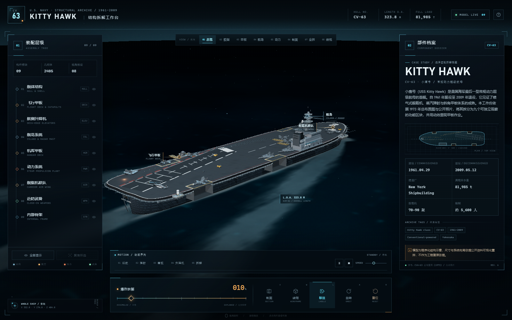
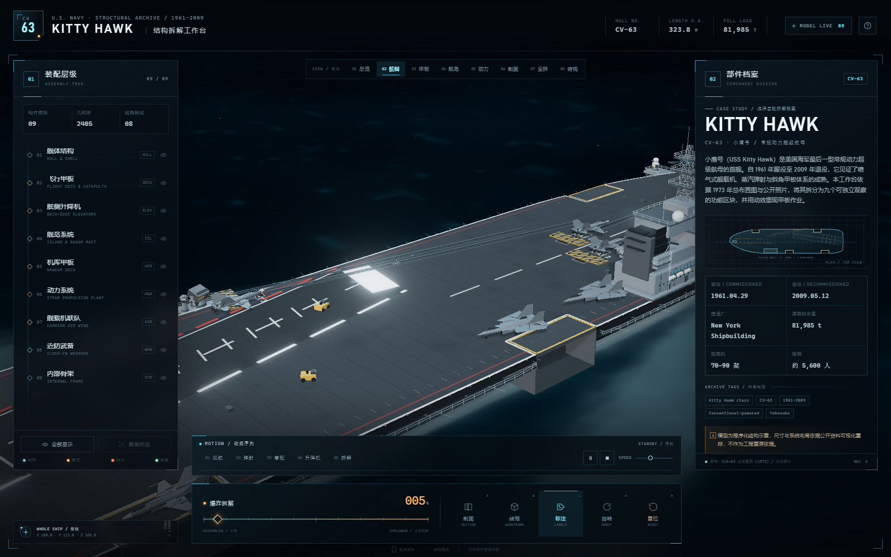
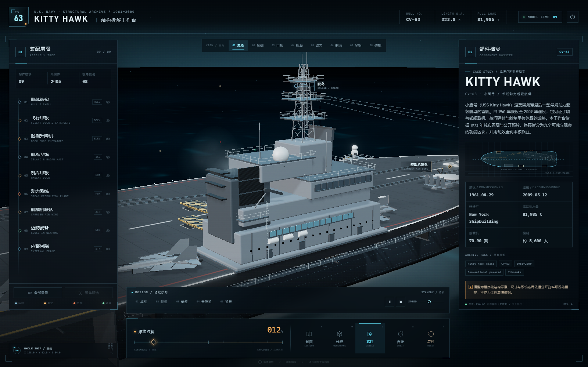
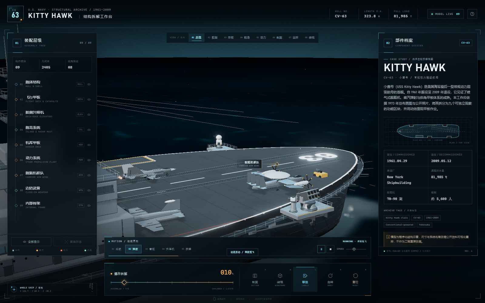
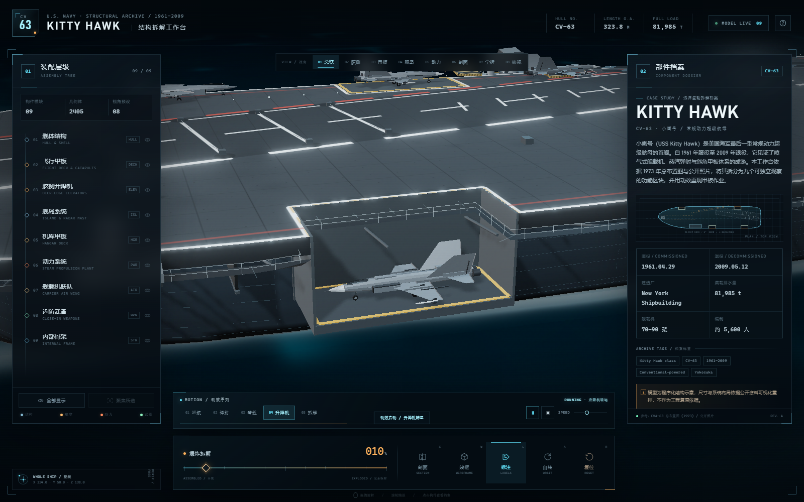
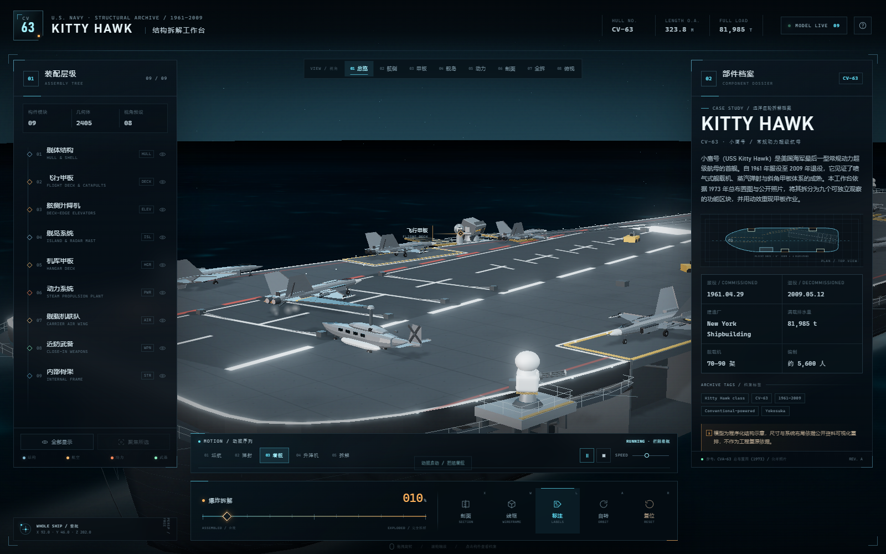
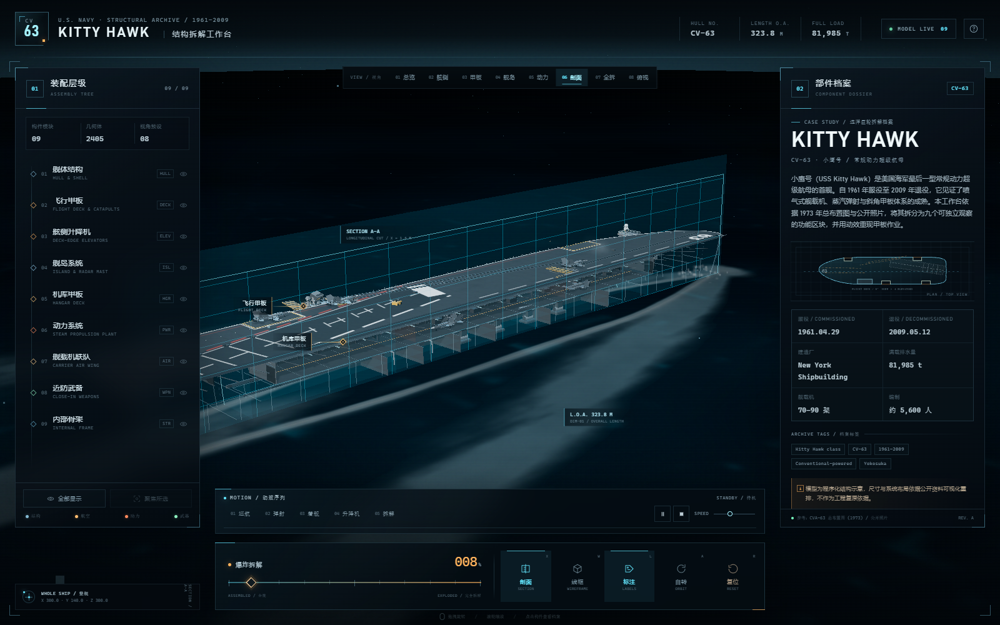
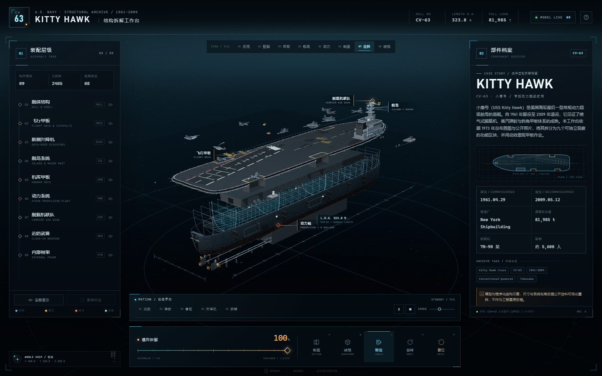

# CV-63 / KITTY HAWK · 结构拆解工作台

以 **USS Kitty Hawk (CV-63) / 小鹰号** 为对象的程序化 three.js 结构工作台。舰体、飞行甲板、舰岛、升降机、机库、动力舱、舰载机与武备全部由代码生成，不依赖任何外部模型；内建甲板作业动效与九个可独立拆解的功能区块。





## 重建依据

模型重建参考 `docs/ref/` 中的三张结构图（小鹰号/小鹰级的三维线框与结构图），并按公开的 CV-63 主尺度校正：

| 项目 | 数值 |
| --- | --- |
| 总长 / LOA | 323.8 m |
| 飞行甲板最大宽 | 76.8 m |
| 船体型宽 | 39.6 m |
| 吃水 | 11.4 m |
| 水线 / 龙骨 | 0 / −11.8 m |
| 飞行甲板面 | +20.6 m |
| 机库甲板 | +9.9 m（净高约 7.6 m） |

参考图第二张把动力标注为“核动力（A4W）”，与 CV-63 的实际配置不符；本模型按小鹰号真实的 **8 座锅炉 + 4 台蒸汽轮机 + 四轴五叶桨（280,000 shp）** 重建，与第一张参考图及史实一致。

## 功能区块（09）

| # | 区块 | 主要文件 | 内容 |
| --- | --- | --- | --- |
| 01 | 舰体结构 | `src/model/hull.js` | 站位型线放样、外飘舷侧、艏艉悬伸、舷侧开口、锚、舰名 |
| 02 | 飞行甲板 | `src/model/flightdeck.js` | 带凹口的甲板轮廓、标线贴图、四部弹射器、拦阻索、喷流挡板、走道栏杆 |
| 03 | 舷侧升降机 | `src/model/elevators.js` | 四部升降平台、导向滑块、甲板—机库往复动画 |
| 04 | 舰岛系统 | `src/model/island.js` | 航海舰桥、Pri-Fly、格构桅、SPS-48E/49/10、雷达罩、烟囱、导航灯 |
| 05 | 机库甲板 | `src/model/hangar.js` | 封闭机库、横梁肋骨、维修工位、照明带、防火帘 |
| 06 | 动力系统 | `src/model/propulsion.js` | 8 锅炉、4 汽轮机、减速齿轮、四轴、五叶桨、舵系、机舱结构 |
| 07 | 舰载机联队 | `src/model/aircraft.js` `airwing.js` | F/A-18、F-14、E-2C、EA-6B、SH-3；折叠翼、起落架、加力、旋翼 |
| 08 | 近防武备 | `src/model/weapons.js` | Mk 29 海麻雀、Mk 15 密集阵、Mk 91 指挥仪、舷侧外伸平台 |
| 09 | 内部骨架 | `src/model/structure.js` | 25 道肋位、纵向桁材、多层甲板、水密舱壁 |

九个区块各自独立成组：可以单独显隐、聚焦、拾取查看档案，也可以按爆炸拆解滑杆分层抽离。

## 动效序列

| 序列 | 时长 | 内容 |
| --- | --- | --- |
| 巡航镜头 | 26 s 循环 | 环绕全舰的相机路径，烟囱烟、艏波、尾流、雷达与螺旋桨持续运转 |
| 弹射起飞 | 11 s | 挡焰板升起 → 蒸汽喷射 → 加力滑跑 → 离舰爬升 → 收起落架 |
| 拦阻着舰 | 12 s | 沿 9° 斜角甲板进场 → 触舰 → 四道拦阻索区减速 → 滑行转弯 |
| 升降机转运 | 10 s | ELEV 3 载机下沉至机库甲板，停留后回升 |
| 拆解演示 | 11 s | 相机环绕 + 九个区块分层抽离，再回到总览 |

连续动效：雷达旋转、密集阵/发射装置扇扫、螺旋桨与旋翼、桅杆摇摆、航行灯闪烁、海面波浪与尾流、粒子烟尘。

动效实现：

- `src/anim/animator.js`：逐帧更新器 + 命名节点 + 序列时间轴 + 速度/暂停控制。
- `src/anim/sequences.js`：五个演出序列，只通过 `api`（相机、升降机、舰载机、粒子、拆解值）驱动场景。
- `src/anim/effects.js`：池化粒子（烟、蒸汽、艏波），提供 `funnelSmoke / steamBurst / bowSpray`。
- `src/model/sea.js`：GLSL 海面与尾迹（开尔文尾流、艉部翻涌、推进器尾流），与雾/色调映射管线一致。

## 启动

```bash
pnpm install
pnpm dev
```

打开 <http://127.0.0.1:5175/>。

生产构建：

```bash
pnpm build
pnpm preview
```

## 操作

| 操作 | 功能 |
| --- | --- |
| 左键拖拽 | 轨道旋转 |
| 滚轮 / 双指捏合 | 推拉镜头 |
| 右键拖拽 | 平移 |
| 点击构件 / 标注 | 打开部件档案，显示选区框 |
| 爆炸拆解滑杆 | 0–100% 分层拆解（各区块带延迟，先后分离） |
| 动效面板 | 巡航 / 弹射 / 着舰 / 升降机 / 拆解；暂停、停止、0.4–2× 速度 |
| `X` | 剖面模式 |
| `W` | 线框模式 |
| `L` | 标注开关 |
| `A` | 自动环绕 |
| `R` | 复位 |
| `1`–`8` | 镜头预设（总览/舷侧/甲板/舰岛/动力/剖面/全拆/俯视） |

> 动效播放时相机由序列接管；点击「停止」或再次点击当前序列即可中断并恢复自由视角。

## 代码结构

```text
index.html                 工作台界面、动效面板、帮助弹层
src/style.css              视觉系统、响应式布局、空间标注、动效面板
src/data.js                九个功能区块的档案、镜头预设
src/ship.js                区块装配、标签锚点
src/main.js                场景/相机/后期、拾取、拆解、剖面、动效 UI 与 API
src/model/
  constants.js             主尺度、甲板轮廓、升降机/弹射器/舰岛/轴系布置
  materials.js             材质库、甲板标线画布贴图、通用纹理
  geometry.js              放样/厚板/栏杆/桁架/合并等几何工具
  hull.js  flightdeck.js  elevators.js  island.js  hangar.js
  propulsion.js  aircraft.js  airwing.js  weapons.js  structure.js
  sea.js                   海面与尾迹着色器
src/anim/
  animator.js              动效引擎
  sequences.js             五个动效序列
  effects.js               粒子系统
tools/shot.mjs             无头 Chrome 截图工具（调试/出图用）
```

## 预览

| 舰岛 | 弹射 |
| --- | --- |
|  |  |

| 升降机转运 | 拦阻着舰 |
| --- | --- |
|  |  |

| 剖面 | 全拆 |
| --- | --- |
|  |  |

## 说明

- 模型为结构示意与可视化重排，尺寸和系统布置依据公开资料与参考图整理，不等同于原舰施工图。
- 参考图中的甲板标线、舰岛细节和雷达布置做了可读性强化；舰载机为低多边形识别模型。
- 海面、尾流、烟尘粒子均为实时着色器/粒子模拟，不依赖外部贴图。
- 首次加载会编译着色器并生成程序化贴图，低端设备建议使用桌面浏览器。
