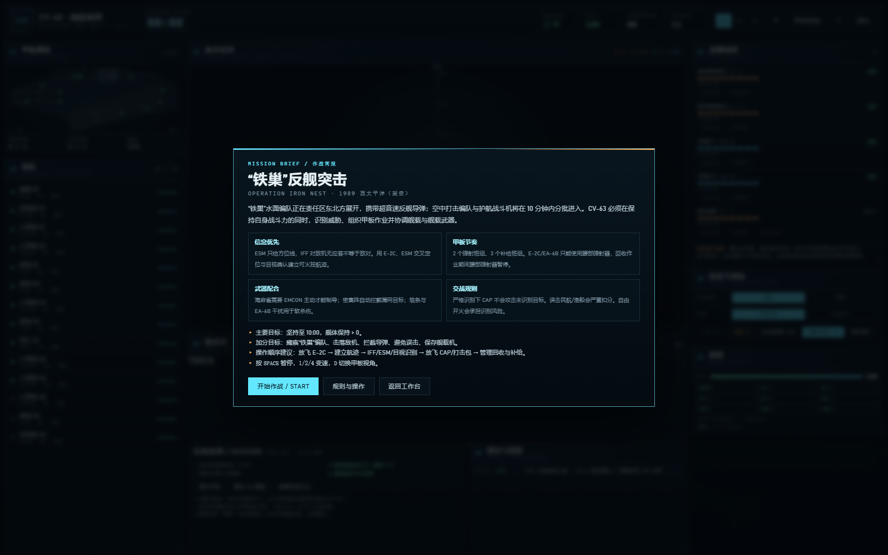

# CV-63 v1.1 · CIC 战役模式设计说明

> 版本：1.1.0 · 2026-10  
> 场景：`OPERATION IRON NEST / 铁巢`（1989 年西太平洋架空兵棋）  
> 玩法参考：《铁巢重炮 Iron Nest》以信息交互驱动的指挥节奏；本实现为独立程序化兵棋，不使用其素材或代码。



---

## 1. 目标

v1.0 已经解决了“看得见”的问题：程序化航母、甲板、舰载机、动效与拆解。v1.1 要解决“用得上”的问题——把同一艘航母变成一个 10 分钟的决策场：

1. **信息不是免费的**：雷达开机、预警机升空、ESM 定位、IFF 询问与目视识别各有代价；玩家要在不完整信息下做决定。
2. **甲板是瓶颈**：飞机不是按钮，机库—升降机—停机位—弹射器—回收—补给是一条有资源上限的流水线。
3. **武器要配合**：海麻雀的射界/制导条件、密集阵的末端补漏、护航舰的远程支援、箔条/干扰的软杀伤，需要按波次编排。
4. **失败可解释**：结算给出舰体、拦截数、误击、损失与评级，下一局知道该改什么。

设计约束：

- 不引入新依赖，不改变 v1.0 的几何参数契约。
- 推演核心纯 JS、固定步进、可确定性复现；浏览器与 Node 测试共用同一套规则。
- 三维表现只读推演状态，不反向修改规则。

---

## 2. 架构

```text
src/game/
  sim.js          固定 0.1 s 步进；command() 是唯一状态入口
  state.js        初始编制、机位、武器站、DC 队、消息
  constants.js    全部平衡参数 / 机型 / 武器 / 场景时间线
  sensors.js      雷达、AEW、ESM、IFF、目视、航迹质量
  deckops.js      升降机、牵引、弹射、回收、补给状态机
  airops.js       舰载机任务、敌机运动、空战、鱼叉、搜救
  defense.js      海麻雀/密集阵/护航舰/箔条/损管/命中
  contacts.js     真实接触的生成、移动、摧毁
  scenario.js     时间线、HQ 情报、目标与结算
  cic.js/.css     CIC 控制台（DOM + Canvas 2D）
  bridge3d.js     推演状态 → three.js 甲板/武器/特效
```

数据流：

```text
player click
   ↓ command()
state  ← sim.step(0.1) ──→ sensors / deckops / airops / defense / scenario
   │
   ├─→ cic.js  (5–8 Hz DOM, 18 Hz canvas)
   └─→ bridge3d.js (每帧：飞机位姿、升降机、炮塔、弹道、命中)
```

- **确定性**：所有随机结果来自 `createRng(seed)`；命令按到达顺序应用。测试对同一命令序列做状态哈希比对。
- **无 DOM 依赖**：`sim.js` 及其依赖可在 Node 直接运行；`tools/test_game.mjs` 不启动浏览器。
- **固定步进**：渲染帧率与推演解耦；`1×/2×/4×` 只改变每帧累积的模拟秒数。

---

## 3. 信息模型

### 3.1 传感器包线（km）

| 传感器 | 高空目标 | 低空/掠海 | 水面 | 反舰导弹（掠海） | 备注 |
| --- | --- | --- | --- | --- | --- |
| SPS-48 舰载雷达 | 230 | 72 | 58 | 30 | 需 EMCON 主动且雷达在线 |
| E-2C 预警机 | 400 | 165 | 260 | 88 | 需要 E-2C 在空中 |
| ESM | 430（仅方位） | 430 | 430 | — | 只对开机辐射源；无距离 |
| 目视（CAP） | 28 | 28 | — | — | 抵近后 8 s 自动确认 |

雷达/预警机航迹带距离与速度；ESM 航迹只有方位线，初始质量 0.22，显示为“ESM 方位线”。

### 3.2 航迹质量

- 每次雷达/AEW 刷新增加 0.20–0.24；目视直接 1.0。
- 无刷新时按 0.016/s 衰减（ESM 为 0.008/s），5 s 后停止快速衰减。
- 35 s 无更新 → `stale`；90 s → 丢失；130 s 移除。
- **火控门槛**：非方位线、质量 ≥ 0.50、已判定敌对/疑似敌对。

### 3.3 识别链

| 动作 | 耗时 | 结果 | 风险 |
| --- | --- | --- | --- |
| IFF 询问 | 5 s | 友军/中立应答并确认；敌机无应答 | 无应答不能作为敌对证据 |
| ESM 交叉定位 | 7 s | 方位线变成带距离航迹，质量 ≥ 0.56，给出辐射源类型 | 需要目标持续开机 |
| 目视识别 | 按距离（20–120 s） | 确认机型与真实身份 | 需要 CAP 在 70 km 内并抵近 |
| 人工判定 | 即时 | 标记敌对/疑似/中立/友方 | 判定错误由玩家承担；误击中立重罚 |
| HQ 情报 | 45 s 冷却 | 对最高威胁航迹给出编队/机型提示 | 信息模糊，不直接给真实身份 |

导弹航迹在首次发现时自动判定为敌对并确认类型——这是唯一“免识别”的例外，因为超低空高速小目标在战术上没有歧义。

### 3.4 EMCON 与 ROE

**EMCON**

- 主动：雷达开机，雷达航迹可用，海麻雀可制导；同时暴露自身位置（场景叙事与敌方射击节奏）。
- 静默：雷达航迹消失，只剩 ESM/AEW；海麻雀无法制导；来袭导弹在 25 km 有额外 14% 概率丢失目标（与 EA-6B/干扰叠加）。

**ROE**

- 严格识别：CAP 只攻击已判定敌对/疑似敌对目标。
- 自由开火：CAP 可攻击未识别空中目标；可能击落民航或渔船，扣 220 分并记为事件。

---

## 4. 甲板调度

### 4.1 编制

- 14 架：E-2C ×1、EA-6B ×2、F-14 ×4、F/A-18 ×6、SH-3 ×1。
- 飞行甲板 12 个停机位（含 E3/E4 升降机平台上的 2 架），机库 3 个机位。
- 2 个弹射班组、3 个补给班组、4 部弹射器、4 部升降机（机库作业只用 E1/E2）。
- 初始 11 架在甲板待命，3 架在机库。

### 4.2 状态机

```text
hangar ──order──> elevating ──> spotting ──> ready
ready ──order──> queued ──> taxi ──> hook ──> stroke ──> airborne
airborne ──bingo/recall/mission end──> inbound ──> holding
holding ──recovery window──> approach ──> trap ──> clear ──> taxiIn
taxiIn ──> service/awaitingService ──> ready
```

### 4.3 资源与时间

| 项目 | 数值 |
| --- | --- |
| 牵引速度/时长 | 7.5 m/s，9–34 s（按机位到弹射器距离） |
| 对位 + 弹射 | 8 s + 4 s |
| 弹射器冷却 | 11 s |
| 升降机循环 | 34 s |
| 着舰进场 / 拦阻 / 脱离 / 滑回 | 17 / 3 / 13 / 12 s |
| 补给 | F/A-18 52 s，F-14 56 s，E-2C 74 s，EA-6B 68 s，SH-3 38 s |
| 班组上限 | 弹射 2，补给 3 |

### 4.4 关键约束

- E-2C / EA-6B 只能使用 CAT 3/4（腰部）；回收作业期间 CAT 3/4 关闭。
- 机库飞机上甲板需要空闲停机位和 E1/E2 之一。
- 回收一次只允许一架；着舰区被占用时腰部弹射无法开始。
- 甲板满时，着舰飞机直接转入机库（本条是防死锁兜底，正常局很少触发）。
- 燃油按秒消耗；返航余量按“当前位置到航母距离 / 返航速度 + 45 s”计算，低于阈值自动返航；耗尽即损失。

---

## 5. 武器协同

| 武器站 | 弹药 | 射程 | 射界中心/半宽 | 周期 | Pk（导弹 / 飞机） | 条件 |
| --- | --- | --- | --- | --- | --- | --- |
| 海麻雀 #1 | 8 | 2–28 km | 090° / 90° | 5.5 s | 0.58 / 0.70 | EMCON 主动、雷达在线、火控航迹 |
| 海麻雀 #2 | 8 | 2–28 km | 270° / 90° | 5.5 s | 0.58 / 0.70 | 同上 |
| 密集阵 #1 | 1500 发 | 0.1–1.9 km | 090° / 100° | 4.4 s | 0.42 / 0.28 | 自包含，静默可用，自动 |
| 密集阵 #2 | 1500 发 | 0.1–1.9 km | 270° / 100° | 4.4 s | 0.42 / 0.28 | 同上 |
| 护航舰 SM-1 | 8 | 1–50 km | 全向 | 10 s | 0.62 / 0.64 | 需要呼叫，6 s 反应 |
| 箔条 | 6 | 11 km | — | 5 s | 0.70 诱骗 | 消耗 1 发 |
| EA-6B 干扰 | — | — | — | — | 末段丢失概率 +16% | EA-6B 在空中 |
| 干扰开关 | — | — | — | — | 再 +12% | 同上 |

附加修正：航迹质量 ≥ 0.8 +8%，AEW 在空中 +4%，干扰 +3%；目标有 ECM 时 −12%。Pk 限制在 8%–94%。

### 5.1 火力分配

- 每个海麻雀发射架最多同时挂 3 条航迹；实战中通常 1–2 条。
- 命中后自动解除该航迹；未命中保留指派并在装填后再次射击。
- 密集阵只自动拦截导弹，不会主动打飞机。
- 自动海麻雀（可选）按质量/射程/射界接管来袭导弹，每架最多 2 条航迹；关闭后必须手动指派。
- 射界按舷别划分：本场景主要威胁来自东北，早期只有右舷海麻雀/密集阵可用；最后一批空射导弹从西北进入，检验左舷射界。

### 5.2 反舰导弹与命中

- 导弹速度 0.7 km/s，掠海高度约 30 m；被雷达发现距离 30 km（AEW 88 km）。
- 命中造成 18–24 点舰体伤害；55% 概率引发火灾，38% 概率造成系统离线，18% 概率波及甲板飞机。
- 火灾 0.4 hp/s，持续 42 s；损管队 3 个，自动按“火灾优先”派遣，系统修理 52 s。
- 雷达离线时海麻雀无法制导；弹射器离线时对应 CAT 不可用；修好后自动恢复。

---

## 6. 空中作战

| 任务 | 机型 | 站距 | 关键行为 |
| --- | --- | --- | --- |
| CAP | F-14 / F/A-18 | 68 km | F-14 拦截半径 150 km，F/A-18 95 km；对已判定目标每 8.5 s 一次交战；可目视识别 35 km 内未知目标 |
| AEW | E-2C | 82 km | 提供 400 km 级探测；自身不交战，遭逼近时向航母规避 |
| EW | EA-6B | 66 km | 提供干扰增益与 ESM 增强；可开关干扰 |
| STRIKE | F/A-18 | 目标 | 4 机 ×2 枚鱼叉；进入 100 km 发射，Pk 0.68（高质量 +0.07） |
| SAR | SH-3 | 救援点 | 搜救被击落机组，+60 分 |

- 敌打击机在 95 km（EMCON 主动）/64 km（静默）发射 1 枚空射反舰导弹后转向脱离。
- 敌护航战斗机主动寻找最近友军空中目标，可击落 CAP/AEW/EW；CAP 也会反击。
- 舰载机损失会生成海面机组标记，可派 SH-3 搜救。

---

## 7. 场景

### 7.1 时间线

| t | 事件 |
| --- | --- |
| 0:02 | HQ 简报：铁巢编队进入责任区 |
| 0:06 | 两个水面辐射源出现（ESM 方位线） |
| 0:14 | ESM 截获 X 波段搜索雷达 |
| 0:32 | 中立民航进入责任区 |
| 1:10 | HQ 建议放飞 E-2C |
| 2:08 / 2:28 | 铁巢 1/2 号舰首批齐射（2 + 1 枚） |
| 3:25 | 空中打击编队 2 批进入 |
| 5:06 / 5:26 | 铁巢第二批齐射（2 + 2 枚） |
| 5:44 | HQ 确认铁巢为两艘导弹驱逐舰 |
| 6:12 | 中立渔船编队出现（方位 214 / 36 km） |
| 7:18 | 敌护航战斗机 2 批进入 |
| 8:06 / 8:26 | 铁巢末批齐射（2 + 2 枚） |
| 8:10 | 末批空射平台从 300° 方向 60 km 进入，发射 2 枚 |
| 9:00 | HQ 通报支援即将到达 |
| 10:00 | 推演结束 |

### 7.2 敌方兵力

- 2 艘导弹驱逐舰（IRON NEST 1/2），各 3 点结构，携带 3 个齐射波次。
- 2 批打击机（t≈3:25）+ 2 批（t≈8:10），每架 1 枚空射反舰导弹。
- 2 批护航战斗机（t≈7:18）。
- 1 架中立民航、1 个中立渔船编队。
- 合计最多约 15 枚反舰导弹（取决于是否被 CAP 提前击落、铁巢是否被瘫痪）。

### 7.3 胜负与评分

- 10:00 时舰体 > 0 即达成主目标；舰体 ≤ 0 立即失败。
- 加分：存活 +320、舰体 ×2、瘫痪铁巢 +180、零误击 +80、击落敌机 +90/架、拦截导弹 +45/枚、击沉驱逐舰 +160。
- 扣分：误击中立 −220、损失舰载机 −55、被命中 −40。
- 评级：S ≥ 900 且舰体 ≥ 60；A ≥ 720 且舰体 ≥ 30；B ≥ 520（或高分但舰体受损严重）；C ≥ 320；失败固定 D。

---

## 8. 平衡基准

| 玩法 | seed 7 结果 |
| --- | --- |
| 完全被动（默认 EMCON 主动，仅密集阵） | 约 5:37 舰体归零 |
| AEW + 2 CAP + ESM/识别 + 4 机对海打击 + 自动海麻雀 | 10:00 存活，舰体 8–70，评级 A/B |

设计意图：信息与甲板决策的收益要大于“多点几下按钮”；错误识别的代价要明显，但不能一枪毙命。

---

## 9. 测试

```bash
node tools/test_game.mjs
```

19 项覆盖：

1. 初始编制 / 机位 / 机库。
2. 简报阶段不推进时间。
3. 甲板机位均在轮廓内，弹射器起终点有效。
4. E-2C 只能使用腰部弹射器。
5. 同时弹射不超过 2 架。
6. 第 3 架正确排队。
7. 机库飞机经升降机上甲板并完成出击。
8. 回收期间腰部弹射被封锁。
9. 召回→拦阻→补给→重新待命，并重新分配停机位。
10. 火控四项拒绝条件（质量/方位线/射界/静默）。
11. 指派后按周期开火、扣弹。
12. 箔条 11 km 近界、载荷消耗与诱骗。
13. EMCON 静默不产生舰载雷达航迹，ESM 方位线保留。
14. IFF 识别民航为中立。
15. 相同命令序列 → 相同状态哈希。
16. 被动必败，失败评级固定 D。
17. 完整指挥链取胜。
18. 长时间推演无 NaN / 负弹药。
19. 6000 步性能 < 1.5 s（本机约 30–40 ms）。

浏览器侧使用 `tools/shot.mjs` 做截图与无头冒烟检查；页面错误收集在 `window.__cvErrors`。

---

## 10. 已知限制

- 战术平面是二维相对坐标，不做真实地球曲率/多雷达站融合；AEW 距离以航母为参考抽象。
- 空战是概率回合制，不做能量机动与导弹不可逃逸区。
- 反舰导弹不做逐发弹道与近炸引信；拦截以 Pk 结算。
- 甲板三维位置做了牵引直线插值，不模拟甲板滑行道与碰撞。
- 单场景、无存档；重新进入会保留暂停状态，刷新页面则重置。
- 兵棋数值以可玩性为目标，不代表真实武器性能。

---

## 11. 后续可扩展

- 多场景/多难度与战役存档。
- 编队协同（多舰共享航迹、CEC）。
- 更细的甲板滑行路径与停机位冲突。
- 反潜/潜艇威胁与 SH-3 声呐任务。
- 语音/无线电文本生成与更丰富的 HQ 交互。
